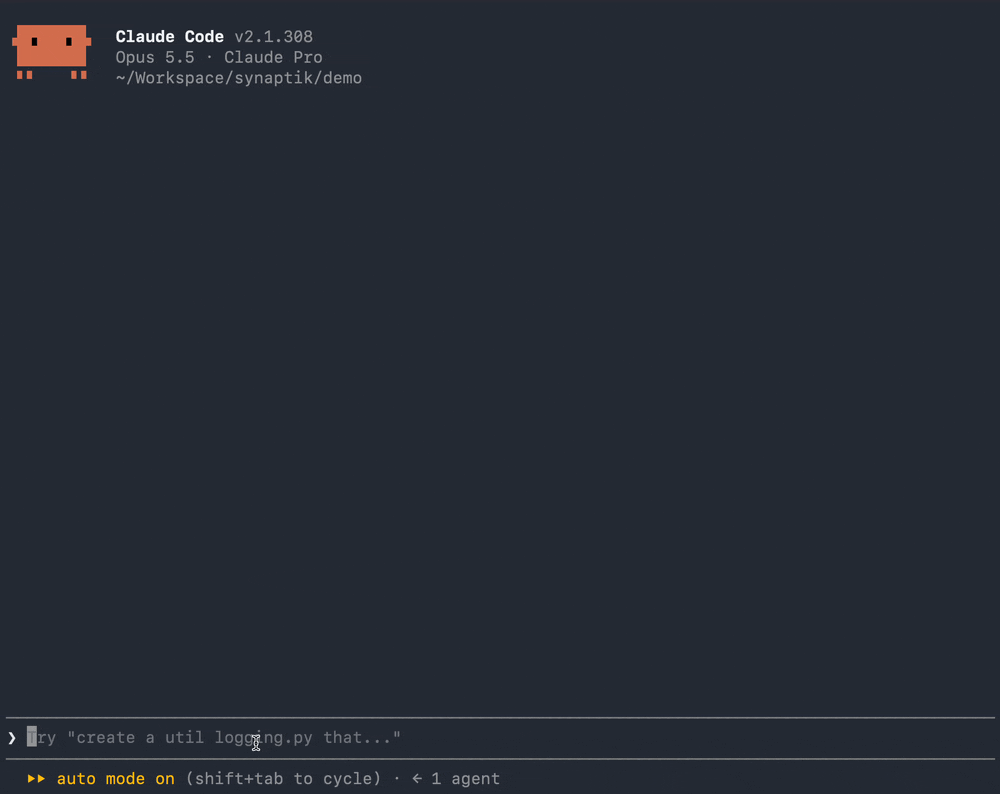

<picture>
  <source media="(prefers-color-scheme: dark)" srcset=".github/assets/readme-banner-dark.png">
  
</picture>

# Synaptik

**Synaptik** (with a **k**) is a mod for Claude Code. Review the agent's reply
in place: go through it block by block — a paragraph, a step in its plan, an
item in a list — and accept it, reject it, or comment on it. Synaptik turns
your review into one prompt, written as if you'd typed it yourself.



Your review appears in the prompt box as a dim suggestion: `Tab` takes it, `⏎`
sends it. Nothing reaches the agent until you send, and what it receives is an ordinary
prompt you saw first — Synaptik adds no markers or identifiers, and never
interferes with the prompt/response flow.

## Status

**v0.2.2, early.** Used daily by its author: accept, reject and comment on any
block of the last reply — in fullscreen right in the reply, in the default
renderer from the navigator above the prompt. What comes next is on the
[roadmap](https://github.com/orgs/synaptik-app/projects/2).

## Install

Requires Claude Code **v2.1.301+** in a terminal; check yours with `claude --version`.

### From the marketplace

This repository is its own plugin marketplace, `synaptik-app`:

```bash
claude plugin marketplace add synaptik-app/synaptik
claude plugin install synaptik@synaptik-app
```

> [!NOTE]
> No GitHub SSH key? Set `CLAUDE_CODE_PLUGIN_PREFER_HTTPS=1` first.
> `claude plugin update synaptik@synaptik-app` gets new versions.

### Offline or air-gapped

Download `synaptik-<version>.zip` from
[Releases](https://github.com/synaptik-app/synaptik/releases) on a connected
machine and carry it over. Then either:

```bash
# one session only, straight from the zip
claude --plugin-dir ./synaptik-<version>.zip

# every session: unzip it into your skills folder
unzip synaptik-<version>.zip -d ~/.claude/skills/
```

On Windows the skills folder is `%USERPROFILE%\.claude\skills\`. To update,
replace the `synaptik` folder there with the newer zip's.

### Turn it off or remove it

```bash
# inside a session: current session only
/synaptik off
/synaptik on

# from your shell: stays off until you enable it again
claude plugin disable synaptik@synaptik-app
claude plugin enable synaptik@synaptik-app

# from your shell: remove it
claude plugin uninstall synaptik@synaptik-app
```

### Keys

After a reply, the band above the prompt says how to start.

**Fullscreen (`/tui fullscreen`)** — no setup. Click the band's hint ("click here to review the reply")
or press `ctrl+x tab`; then click a block, or stay on the keyboard. Outside a
review the reply is plain text you can select.

| | Mouse | Keyboard |
|---|---|---|
| Start reviewing | click the band's hint, then ↑/↓ or a block | `ctrl+x tab` |
| Move between blocks | ↑ / ↓, Home / End | `j` / `k` |
| Choose an action | ← / → | ← / → |
| Apply it | ⏎, or click it | ⏎ |
| Apply directly | `a` accept · `x` reject · `c` comment | same |
| Take a mark off | Backspace | the same action again |
| Done | `q` | `q` |

A comment is typed right under its block; `\` then ⏎ starts a new line, a paste
goes into it, and after a click `ctrl+u` clears it.

**Default renderer** (`/tui default`) — the navigator above the band shows the
selected block:

| | Keys |
|---|---|
| Start reviewing | `ctrl+x tab` |
| Move between blocks | ↑ / ↓ |
| First / last block | Home / End |
| Choose an action | Tab / ⇧Tab |
| Apply it | ⏎ |
| Apply directly | `a` accept · `x` reject · `c` comment |
| Done | Esc |

### Known limits

- **Fullscreen** reviews the reply in place. **The default renderer** cannot redraw what has
  scrolled off, so its navigator shows the selected block itself, above the
  prompt — and may not appear on narrow terminals: Claude Code holds back a pane
  opened unasked below about 144 columns. The band then offers to open it.
- **Esc doesn't end a fullscreen review — `q` does**: Claude Code doesn't tell a
  mod about Esc.
- **While reviewing, the reply's text can't be selected**: each block takes the
  mouse. Outside a review it can.
- **Only the last reply** can be marked, and marks last for the session — they
  are not saved, and nothing is written into the conversation.
- **A Claude Code update can break Synaptik:** it is built on the young mods
  API. [An issue](https://github.com/synaptik-app/synaptik/issues/new/choose)
  with your `claude --version` helps.

## What it can access

A Claude Code mod runs with your own permissions and is not sandboxed. Synaptik:

- reads the session's transcript and the prompt box, to draw marks and propose
  your review as a prompt;
- proposes that prompt in the prompt box, as a suggestion. It never submits:
  you take the suggestion and send it yourself.

It reads and writes no files, makes no network requests, runs no commands and
registers no tool hooks. Your marks stay in memory for the session. More in [SECURITY.md](SECURITY.md).

## Contributing

Found a bug, or something that felt wrong or missing on a real reply?
[An issue](https://github.com/synaptik-app/synaptik/issues/new/choose) is the
most useful thing you can send. Ideas and design discussion are welcome; see
[CONTRIBUTING.md](CONTRIBUTING.md). `docs/DECISIONS.md` records what was decided
and what was deliberately left out, so a proposal is easier to argue for against
that than from scratch. Security issues: [SECURITY.md](SECURITY.md).

## License

Apache 2.0 — see [LICENSE](LICENSE).

---

Synaptik is an independent open-source project, not affiliated with or endorsed
by Anthropic. Claude and Claude Code are trademarks of Anthropic.
