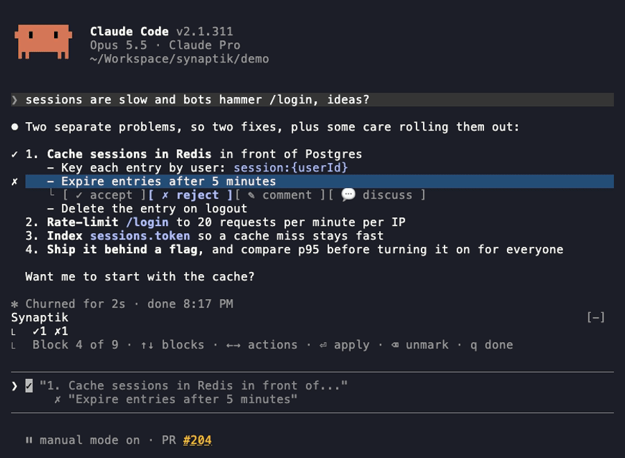

<div align="center">

<picture>
  <source media="(prefers-color-scheme: dark)" srcset=".github/assets/readme-banner-dark.png">
  
</picture>

# Synaptik

**Review Claude's reply in place, and send your review as one prompt.**

[Install](#install) · [Keys](#keys) · [Roadmap](https://github.com/orgs/synaptik-app/projects/2) · [Contributing](CONTRIBUTING.md)

[](https://code.claude.com/docs)
[](#known-limits)
[](https://github.com/synaptik-app/synaptik/releases)
[](LICENSE)
[](https://github.com/synaptik-app/synaptik/issues/new/choose)

</div>

Synaptik (with a **k**) is an open-source terminal mod for Claude Code: go
through the agent's last reply block by block — a paragraph, a step in its plan,
an item in a list — accept, reject or comment on each, discuss any block in a
thread, and send the whole review as one prompt. An independent project, not
affiliated with Anthropic.

<p align="center">
  
</p>

Your review appears in the prompt box as a dim suggestion: `Tab` takes it, `⏎`
sends it. Nothing reaches the agent until you send, and what it receives is an
ordinary prompt you saw first.

## Install

Requires Claude Code **v2.1.301+** in a terminal; check yours with
`claude --version`.

```bash
claude plugin marketplace add synaptik-app/synaptik
claude plugin install synaptik@synaptik-app
```

> [!NOTE]
> No GitHub SSH key? Set `CLAUDE_CODE_PLUGIN_PREFER_HTTPS=1` first.
> `claude plugin update synaptik@synaptik-app` gets new versions.

<details>
<summary><b>Offline or air-gapped</b></summary>

Download `synaptik-<version>.zip` from
[Releases](https://github.com/synaptik-app/synaptik/releases) on a connected
machine and carry it over. Then either:

```bash
# one session only, straight from the zip
claude --plugin-dir ./synaptik-<version>.zip

# every session: unzip it into your skills folder
unzip synaptik-<version>.zip -d ~/.claude/skills/
```

On Windows the skills folder is `%USERPROFILE%\.claude\skills\`. To update,
replace the `synaptik` folder there with the newer zip's.

</details>

<details>
<summary><b>Turn it off or remove it</b></summary>

```bash
# inside a session: current session only
/synaptik off
/synaptik on

# from your shell: stays off until you enable it again
claude plugin disable synaptik@synaptik-app
claude plugin enable synaptik@synaptik-app

# from your shell: remove it
claude plugin uninstall synaptik@synaptik-app
```

</details>

## Why

| Without Synaptik | With Synaptik |
|---|---|
| You quote "in step 3 you said…" to point at a part of the reply | You mark the block itself, in place |
| Each correction becomes its own follow-up prompt | Your whole review goes out as one prompt |
| You retype what you accept and what you don't | Accept, reject or comment per block. Synaptik writes it up as plain text you see before sending |
| To discuss one part, you ask in the main chat, and the back-and-forth fills its context. `/btw` answers one side question, with no follow-ups | Open a thread on that block and follow up on the side. Only its outcome reaches the main chat, and only if you include it |

## What it does

- **Mark blocks:** accept, reject or comment on each block, and send them as one
  prompt.
- **Threads:** discuss a block on the side and follow up. Only its outcome — the
  actions, decisions and open questions you reached — goes out with your review,
  if you include it.
- **Code lines and table rows:** step into a code block or table, and mark it
  line by line or row by row (fullscreen).

## Keys

After a reply, the band above the prompt says how to start.

**Fullscreen (`/tui fullscreen`):** click the band's hint ("click here to review
the reply"), or press `ctrl+x tab`; then click a block, or stay on the keyboard.

| | Started with a click | Started with `ctrl+x tab` |
|---|---|---|
| Start reviewing | click the band's hint, then ↑/↓ or a block | `ctrl+x tab` |
| Move between blocks | ↑ / ↓, Home / End | `j` / `k` |
| Choose an action | ← / → | ← / → |
| Apply it | ⏎, or click it | ⏎ |
| Apply directly | `a` accept · `x` reject · `c` comment · `d` discuss | same |
| Step into a code block or table, or out | `s` | `s` |
| Take a mark off | Backspace | `a` / `x` again |
| Done | `q` | `q` |

A comment is typed right under its block; `\` then ⏎ starts a new line, a paste
goes into it, and after a click `ctrl+u` clears it. Stepped into a code block or
table, the actions apply to the selected line or row, and `q` steps out first.

<details>
<summary><b>Default renderer</b> (<code>/tui default</code>)</summary>

The navigator above the band shows the selected block: Claude Code can't redraw
what has scrolled off.

| | Keys |
|---|---|
| Start reviewing | `ctrl+x tab` |
| Move between blocks | ↑ / ↓ |
| First / last block | Home / End |
| Choose an action | Tab / ⇧Tab |
| Apply it | ⏎ |
| Apply directly | `a` accept · `x` reject · `c` comment · `d` discuss |
| Done | Esc |

On a narrow terminal the navigator may not appear at first: Claude Code holds
back a pane opened unasked below about 144 columns. The band then offers to open
it.

</details>

## Known limits

- **Esc doesn't end a fullscreen review — `q` does:** Claude Code doesn't tell a
  mod about Esc.
- **Only the last reply** can be marked, and marks last for the session — they
  are not saved, and nothing is written into the conversation.
- **While reviewing, the reply's text can't be selected:** each block takes the
  mouse. Outside a review it can.
- **A Claude Code update can break Synaptik:** it is built on the young mods
  API. [An issue](https://github.com/synaptik-app/synaptik/issues/new/choose)
  with your `claude --version` helps.

## What it can access

A Claude Code mod runs with your own permissions and is not sandboxed. Synaptik
reads the session's transcript and the prompt box, and proposes your review in
the prompt box — it never submits. When you discuss a block, it asks the same
model and account as your session, using its tokens. It reads and writes no
files, runs no commands and registers no tool hooks.

More in [SECURITY.md](SECURITY.md), [PRIVACY.md](PRIVACY.md), and the
[hooks it registers](docs/spec/08-claude-code-api.md#hooks-and-calls-in-use).

## Contributing

Found a bug, or something that felt wrong or missing on a real reply?
[An issue](https://github.com/synaptik-app/synaptik/issues/new/choose) is the
most useful thing you can send. Ideas and design discussion are welcome; see
[CONTRIBUTING.md](CONTRIBUTING.md). `docs/decisions/` records what was decided
and what was deliberately left out, so a proposal is easier to argue for against
that than from scratch. Security issues: [SECURITY.md](SECURITY.md).

## License

Apache 2.0 — see [LICENSE](LICENSE).

---

Synaptik is an independent open-source project, not affiliated with or endorsed
by Anthropic. Claude and Claude Code are trademarks of Anthropic.
